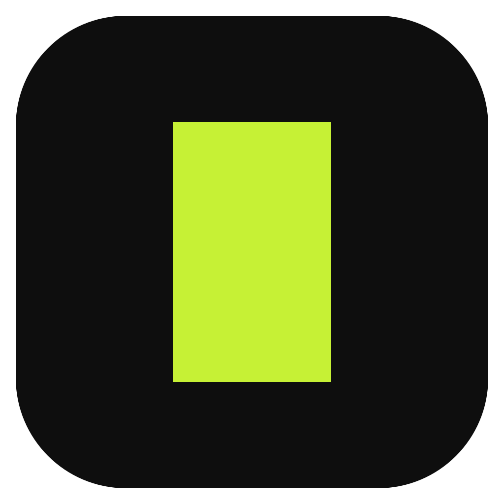
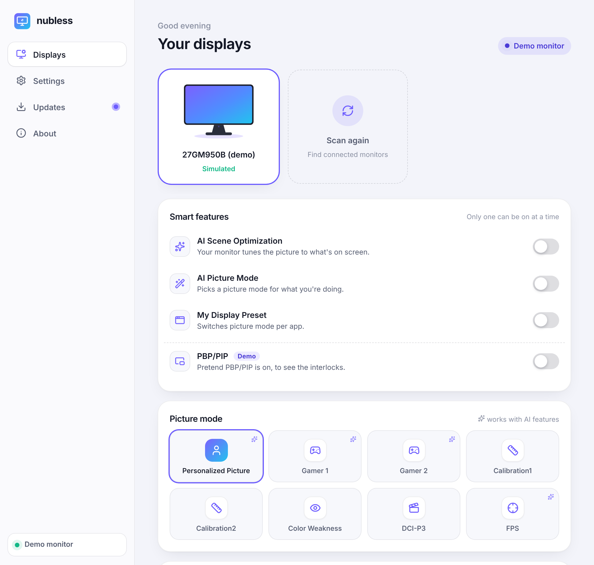
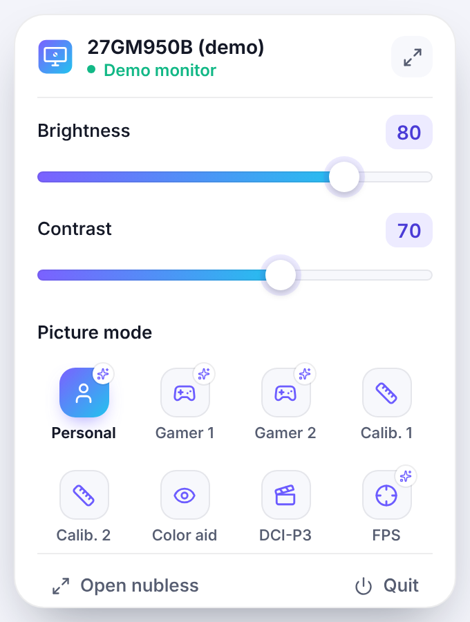

<div align="center">



# nubless

**Never touch the joystick nub under your monitor again.**

Safe, open-source, cross-platform control for the **LG UltraGear AI 27GM950B**, over standard DDC/CI.

[](https://github.com/winb1g/nubless-monitor-control/actions/workflows/ci.yml)
[](LICENSE)


[Download](#install) · [Quick start](#quick-start) · [Safety](#safety) · [Docs](#documentation) · [Contributing](#contributing)

<picture>
  <source media="(prefers-color-scheme: dark)" srcset="docs/assets/window-dark.png">
  
</picture>

<sub>Shown in demo mode, with a simulated monitor.</sub>

</div>

## What is nubless?

nubless replaces the monitor's on-screen menu (OSD) with an app on your desktop. It talks to the monitor over DDC/CI, the same channel LG's own *LG Switch* uses, so you can change picture settings from a window, a tray popover, or a keyboard shortcut instead of from the nub. It is written in Rust, with a Tauri 2 and Svelte desktop app and a command-line tool.

> [!NOTE]
> **Early software.** Reads are verified on a real 27GM950B. Brightness, picture mode, AI Scene Optimization and AI Sound writes are verified against the monitor's own menu. Everything else is read-only until it has been checked on hardware (**Labs** exists for controls that are decoded but not yet confirmed; none are in it right now). Not affiliated with LG Electronics.

## Features

<table>
<tr>
<td valign="top">

- **Picture** – brightness, contrast, and all eight picture modes
- **Smart features** – with LG's own interlocks, so incompatible features never collide
- **Gaming and sound controls** – Response Time, Adaptive-Sync, Motion Blur Reduction and volume are confirmed on hardware
- **Tray popover** – quick brightness and picture mode from the system tray
- **Keyboard shortcuts** – global and rebindable
- **Two or more monitors** – each keeps its own settings, original settings and undo; pick one, or link them to change all together
- **Start at login**, light and dark themes, and one-click updates
- **Labs** – opt in to controls that are decoded but not yet confirmed on hardware
- **CLI** – script everything, with undo and a simulated monitor for testing

</td>
<td valign="top" align="center">

<picture>
  <source media="(prefers-color-scheme: dark)" srcset="docs/assets/tray-dark.png">
  
</picture>

</td>
</tr>
</table>

## Safety

nubless makes two promises, and enforces both in code and in tests ([`SAFETY.md`](SAFETY.md)):

1. **It will never brick your display.** Factory resets, calibration and LUT channels, power, EDID and every unmapped code are on a hard-coded deny-list that no profile, flag or user input can override. Firmware is permanently out of scope.
2. **It can't leave your settings in a mess.** Sliders stay inside safe ranges, features that LG's firmware keeps apart stay apart, and writes the monitor refuses are rolled back. Your original settings are saved the moment nubless first connects, before it changes anything, so **Reset to my original settings** always works.

## Install

Download the installer for your system from the [latest release](https://github.com/winb1g/nubless-monitor-control/releases/latest):

| System | Package |
|---|---|
| **Windows** | `.exe` installer (not code-signed yet, so SmartScreen may warn: choose *More info*, then *Run anyway*) |
| **macOS** | universal `.dmg` |
| **Linux** | `.AppImage`, `.deb` or `.rpm` |

Turn on **DDC/CI** in the monitor's menu (it is on by default). On Linux, load the `i2c-dev` module and give your user access to `/dev/i2c-*`. If LG Switch is running, quit it to avoid collisions: its service also talks DDC/CI, and nubless paces and retries its messages but can't control LG's.

No monitor handy? Try the app against a simulated one:

```bash
cd apps/desktop && npm install && npx tauri dev -- -- --demo
```

## Quick start

Build the command-line tool (needs Rust 1.80+):

```bash
cargo build --release
```

```bash
nubless list                          # which displays are supported (read-only)
nubless --monitor 1 get               # with several monitors: pick one by its number in `list`
nubless --all set brightness 60       # ...or change every supported monitor at once
nubless get                           # read every control
nubless set brightness 60             # change one (read back, journaled)
nubless undo                          # undo the last change
nubless snapshot restore --baseline   # put back what you had before nubless
nubless controls                      # what each control is, how sure we are, and why
nubless --mock get                    # a simulated 27GM950B, no hardware needed
nubless --experimental set adaptive-sync basic   # asks "Keep this change?", reverts in 5 s
```

## Two or more monitors

nubless connects to every supported monitor it finds, even several of the same model.

- **Each monitor is its own.** It has its own original settings and undo history, kept by its EDID serial number (or the port it's plugged into, when it reports no serial). "Reset to my original settings" and Undo only touch the monitor they're for.
- **Monitors carry the names your OS gives them**, such as "LG ULTRAGEAR+ (2)" on macOS, with the model and port (`DP-1`, `DISPLAY2`) underneath.
- **Pick a monitor** from the tabs at the top of the window or the numbered buttons in the tray popover. nubless remembers your pick.
- **Change all together** links them: every slider, picture mode, shortcut, Undo and Reset goes to every connected monitor. A monitor that refuses a change is named in the message and doesn't stop the others.
- **Losing a monitor isn't fatal.** When switching VRR makes a monitor drop off and come back, nubless finds that same monitor again and leaves the others alone.

Try it without the hardware: `npx tauri dev -- -- --demo=3` starts three simulated monitors, and `NUBLESS_MOCK_MONITORS=3 nubless --mock --all get` does the same for the CLI.

## What works today

| | Controls |
|---|---|
| ✅ **Read and write** | Brightness and contrast (within safe ranges), Black Stabilizer, Response Time, Adaptive-Sync/VRR, Motion Blur Reduction (needs Adaptive-Sync Off), color temperature presets, AI Upscaling, volume, mute, all 8 picture modes, AI Scene Optimization, AI Sound |
| 🧪 **Write behind `--experimental` / Labs** | none right now: the next control to become writable goes here until its hardware card passes |
| 👁 **Read-only** | The Manual color temperature slider (decoded, kelvin), RGB gains, aspect ratio, firmware level, usage hours, Dual-Mode state |
| ⛔ **Blocked on purpose** | Input switching (it can cut the DDC link), and everything on the deny-list |

<details>
<summary>Full control table, with VCP codes</summary>

| Control | Code | Status |
|---|---|---|
| Brightness, Contrast | `0x10`, `0x12` | read ✔ · write: safe policy (standard MCCS) |
| Black Stabilizer, Response Time, Adaptive-Sync/VRR | `0xF9`, `0xF7`, `0xF8` | read ✔ · write ✔ (OSD-verified, fw 3.05, 2026-10-30), with the Keep/Revert prompt |
| Volume, Mute | `0x62`, `0x8D` | read ✔ · write ✔ (OSD-verified, fw 3.05, 2026-10-30) |
| Picture mode (all 8 modes) | `0x15` | read ✔ · write ✔ (OSD-verified), through the AI interlock |
| AI Scene Optimization, AI Sound | `0xA6` sub-commands 2, 6 | read ✔ · write ✔ (OSD-verified) |
| Manual color temperature slider (`0x69`), RGB gains, aspect ratio | various | read ✔ · not writable yet (writes untested) |
| Input | `0x60` | read ✔ · **blocked**: switching input can cut the DDC link (dead end) |
| Firmware level, usage hours, Dual-Mode state | `0xC9`, `0xC0`, `0xB1` | read-only |
| Interlocks (AI features, PBP/PIP, picture modes that block AI) | — | done, from LG Switch's own logic ([`docs/rules.md`](docs/rules.md)) |

The control map with evidence is in [`docs/research/05-screen-settings-panel.md`](docs/research/05-screen-settings-panel.md).

</details>

## Documentation

| | |
|---|---|
| [`SAFETY.md`](SAFETY.md) | The safety contract and how it is enforced |
| [`docs/rules.md`](docs/rules.md) | The interlock rules between features |
| [`docs/verify-on-hardware.md`](docs/verify-on-hardware.md) | Hardware test checklist |
| [`docs/hardware-test-cards.md`](docs/hardware-test-cards.md) | Step-by-step test cards for the Labs controls |
| [`docs/mapping-guide.md`](docs/mapping-guide.md) | How to map a control safely |
| [`docs/roadmap.md`](docs/roadmap.md) | Where this is going |
| [`docs/design-system.md`](docs/design-system.md) | Tokens, motion, components and the design kit for the UI |
| [`docs/research/`](docs/research/README.md) | The reverse-engineering research behind it all |

<details>
<summary>Project layout</summary>

| Path | What |
|---|---|
| `crates/nubless-core` | Profiles, capabilities parser, write guard, controller (pacing, read-back, rollback, journal), interlock rules, mock monitor. No hardware dependencies. |
| `crates/nubless-hw` | Real DDC/CI through [`ddc-hi`](https://crates.io/crates/ddc-hi): Windows `dxva2`, Linux `i2c-dev`, macOS. |
| `crates/nubless-cli` | The `nubless` command. |
| `apps/desktop` | The desktop app: Svelte UI (`src/`) and Tauri shell (`src-tauri/`), whose monitor thread owns the connection. |
| `docs/` | Safety rules, interlocks, hardware checklist, roadmap, and the research behind them. |

To work on the UI alone, `npm run dev` in `apps/desktop` serves it in a normal browser with a built-in preview backend.

</details>

## Contributing

The most useful help right now is **mapping**: running the read-only `vcp-diff` around one OSD setting at a time and recording the result. Start with [`docs/mapping-guide.md`](docs/mapping-guide.md) and [`CONTRIBUTING.md`](CONTRIBUTING.md).

## Legal

nubless is independent interoperability work on hardware its authors own. "LG", "LG Switch" and "UltraGear" are trademarks of LG Electronics; nubless is not affiliated with or endorsed by LG. No LG binaries, decoded string dumps or assets are included. Use at your own risk.

## License

nubless is free software, released under the [GNU General Public License v3.0](LICENSE). You may use, study, modify and share it, but anyone who distributes it or a modified version must do so under the same license and make the corresponding source code available.
